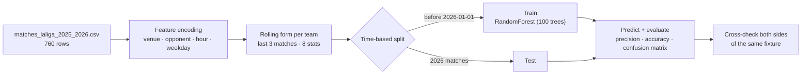

<div align="center">

# ⚽ Football Match Outcome Prediction — LaLiga 2025/26

**A Random Forest that predicts whether a team will win its next match, trained on a full LaLiga season with leakage-free "recent form" features and an honest time-based evaluation.**


</div>

---

## At a glance

| | |
|---|---|
| 📅 **Data** | Full LaLiga 2025/26 season: 20 teams · 38 matchweeks · 380 matches (Aug 2025 – May 2026) |
| 🧾 **Rows** | 760 (each match seen from both teams' perspective), 17 raw columns |
| ✂️ **Split** | Time-based: train on 2025, test on 2026 (no shuffling, no peeking at the future) |
| 🎯 **Target** | Did the team **win**? (draws and losses = 0) |
| 📈 **Result** | Win-prediction precision of **51.5 %**, against a **38.0 %** base rate in the test period |

## Results

How often is the model right **when it says "this team will win"**?

| Approach | Precision on 2026 matches | |
|---|---|---|
| Base rate (pick a team at random) | **38.0 %** | `███████▌` |
| Baseline model: venue, opponent, kick-off hour, weekday | **46.4 %** | `█████████▎` |
| + Rolling 3-match form features | **51.5 %** | `██████████▎` |

The baseline reaches 59.6 % accuracy, but accuracy alone is misleading here: only 38 % of rows are wins, so a model that always predicts "no win" would score 62 %. That is why **precision on the positive class** is the headline metric, and why the class balance is reported next to it.

<details>
<summary><b>Baseline confusion matrix (418 test rows)</b></summary>

|  | Predicted: no win | Predicted: win |
|---|---|---|
| **Actual: no win** | 185 | 74 |
| **Actual: win** | 95 | 64 |

</details>

## Pipeline



## Feature engineering

**Match context** (known before kick-off):

| Feature | How it's built |
|---|---|
| `venue_code` | Home / Away → categorical code |
| `opp_code` | Opponent → categorical code |
| `hour` | Kick-off hour parsed from `HH:MM` |
| `day_code` | Day of week from the match date |

**Recent form** (the improvement): for each team, the **average of its previous 3 matches** for goals for/against, shots, shots on target, fouls, corners, yellow and red cards.

```python
group[new_cols] = group[cols].rolling(3, closed="left").mean()
```

`closed="left"` is the critical detail: the window **excludes the current match**, so the model never sees the result it is trying to predict. Without it, goals scored in the match itself would leak into the features and the scores would be meaningless.

## What an interviewer might ask

- **Why not a random train/test split?** Matches are a time series. Shuffling would train on May to predict February, and inflate the scores.
- **Why precision over accuracy?** Wins are the minority class (38 %). The useful question is "when the model backs a team, how often is it right?"
- **Why does each match appear twice?** Each row is one team's view of a fixture. Merging the two predictions for the same date lets you keep only fixtures where the model backs one side and not the other: 33 such cases in the test set, 18 correct (54.5 %).

## Quick start

```bash
python -m venv .venv && source .venv/bin/activate
pip install -r requirements.txt scikit-learn
jupyter notebook Partidos.ipynb
```

## Project structure

```text
├── matches_laliga_2025_2026.csv   # Match-level stats, one row per team per match
├── Partidos.ipynb                 # Feature engineering, training, evaluation
└── requirements.txt
```

## Next steps

- More history (several seasons) and tuning `n_estimators` / `min_samples_split` with time-series cross-validation
- Opponent-form features, Elo-style team ratings, and a three-class target (win / draw / loss)
- Calibrated probabilities instead of hard labels

---

<div align="center">

Built by **Marcos** · [@mmartinezvaras](https://github.com/mmartinezvaras)

</div>
